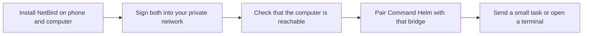

# Link your NetBird network

NetBird is optional. It provides a private route; Command Helm still uses its own pairing key and certificate check.

1. Install the official [NetBird clients](https://netbird.io/download) on your phone and bridge computer.
2. Sign each device in through NetBird itself. Use the network and access rules you administer. Command Helm does not ask for your NetBird password or API token.
3. Confirm both devices appear in your NetBird account. Permit only the phone-to-bridge connection and any deliberate computer-to-computer SSH routes you need.
4. Start the bridge on the computer's private network address using the [setup guide](backend-setup.md). Pair using that address and the certificate fingerprint shown on the computer.
5. In Command Helm Connections, enable NetBird discovery if you want the bridge to read the locally installed client's status. The peer list is informational: appearing there does not automatically give a peer terminal access.
6. Test while the phone is using cellular data and NetBird is connected. Check that the intended computer performs the work.

If a peer is unavailable, check NetBird on both devices and the computer's sleep state. If NetBird is connected but Helm cannot connect, check the bridge process, its private listening address and your network access rules. Do not bypass a fingerprint mismatch.

See [NetBird's documentation](https://docs.netbird.io/) for account and network administration. Disable discovery in Command Helm at any time; this does not sign you out of NetBird or change your network.
